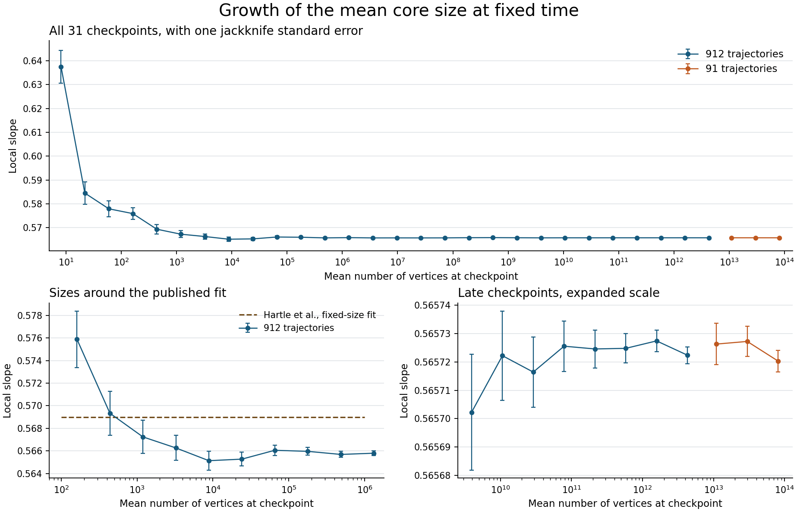

# Numerical evidence for growth of the friend-tree core

The core consists of the vertices of degree at least two. Across 912 continuous-time (CT) trajectories, the pooled slope is **0.5657230 ± 0.0000032**. At the last checkpoint, 91 trees have mean size **8.117 × 10¹³** and instantaneous slope **0.5657203 ± 0.0000038**. Each error is one Monte Carlo standard error. Every theorem in the [proofs](../proofs/README.md) is independent of these simulations.

## Run the small example

From the repository root, run the following with Bash, gzip, G++, awk and Python 3. The script compiles the generator, grows 64 new trees from seed 20261123 to time 17, and prints the local slope and its error at all 17 checkpoints. The early values fluctuate before settling near 0.566. It then reproduces the published tables and fits from the included trajectories. The full demo took 1.90 s on an AMD Ryzen 7 5800X with GCC 13.3 and Python 3.12.3.

```bash
cd simulations
sha256sum -c SHA256SUMS
bash demo.sh
```



Each point is the ratio of the sample sums of conversion intensity and core size. Bars show one run-level jackknife standard error. The x coordinate is the sampled mean number of vertices at that time. In the lower left, the dashed segment shows Hartle et al.'s single fitted exponent over their fixed-size range. The gap between colors marks the change from 912 trajectories to 91. [All 31 rows and paired adjacent slopes](local_slopes.tsv)

## Comparison with Hartle et al.

Hartle, Krapivsky, Redner and Zhang give an isotropic-redirection estimate of **0.569** from nonlinear least squares on the mean number of core nodes at fixed sizes from 100 through one million, with 2,400 realizations per point. The figure caption specifies the range, sample size and fitting method. It supplies neither the raw realizations nor a weighting prescription. [Hartle et al., Fig. 6](https://arxiv.org/html/2604.01540v1#S3.F6)

For a direct comparison, we grew **2,400 new discrete trees**, each starting at the three-vertex path, and recorded its core at nine approximately log-spaced sizes, including both endpoints. At every step a uniform vertex chooses a uniform neighbor to receive the new leaf. Adjacency lists give the actual neighbors, with a leaf's sole neighbor stored directly. The same runs contribute to every size. [Generator](fixed-size/fixed_size.cpp) · [2,400 trajectories](fixed-size/core_counts.tsv.gz) · [Means and adjacent log–log slopes](fixed-size/summary.tsv)

| Data and fitting window | Fit of mean core to $`a x^b`$ | Linear fit of log mean core to log size |
|---|---:|---:|
| Discrete trees, fixed $`x=N`$, 100 to 1,000,000 | 0.5660272 ± 0.0002417 | 0.5675481 ± 0.0004706 |
| Archived CT trees, $`x=3e^t`$, integer $`t=4`$ to 12 | 0.5655751 ± 0.0004760 | 0.5676083 ± 0.0008194 |

Both fits give each checkpoint equal weight in the indicated response units and fit a free amplitude. The first minimizes squared residuals in core counts, which gives larger cores more influence for a given fractional error. The second minimizes squared residuals in log mean core. Errors come from refitting after deleting one entire trajectory at a time. The CT row uses every archived checkpoint whose theoretical mean size lies within the published range, about 164 to 488,264 vertices. Its endpoint secant, $`[\log\bar C(12)-\log\bar C(4)]/8`$, is **0.5681921 ± 0.0009301**. [Fit code](fit_window.py) · [Fit output](finite_window.txt)

The estimated slopes vary with size. The fixed-size slope from 100 to 316 is 0.56927 ± 0.00348 and from 316,228 to one million it is 0.56635 ± 0.00037. The instantaneous CT slope is 0.56933 ± 0.00193 at mean size 439 and 0.56569 ± 0.00026 at mean size 482,711. The early slopes fluctuate, and both of our full-window fixed-size fits fall below 0.569. Changing the response units moves the fitted exponent. The difference from the published value remains unexplained.

Two independent implementations also tested the transition rule directly. In the [fixed-size and fixed-time comparison](independent-check/README.md), the largest discrepancy from the exact mean core size through size 21 was 1.167 standard errors. At fixed times six and eight, the means from the direct and fast samplers differed by 0.926 and 0.381 combined standard errors. The [second direct-chain audit](cross-check/README.md) also compares conversion intensities and tests deliberate changes to the model.

## What the CT estimators measure

At fixed tree size $`n`$, write $`C_n`$ for the number of core vertices. In continuous time every vertex fires at rate one. The total population $`N(t)`$ is a Yule process started at three and is independent of the discrete jump chain. Its mean is $`3e^t`$ and $`N(t)-3`$ is negative binomial with shape 3 and success probability $`e^{-t}`$. Thus $`\mathbb E[C(t)]=\sum_n P(N(t)=n)\mathbb E[C_n]`$. Substituting $`n=3e^t`$ into a fixed-size curve would discard the spread in actual sizes at a checkpoint.

If $`L_u`$ and $`D_u`$ count the leaf neighbors and degree of a core vertex, define $`S=\sum_u L_u/D_u`$. Each successful conversion adds one core vertex, so $`d\mathbb E[C]/dt=\mathbb E[S]`$. Since $`d\log\mathbb E[N]/dt=1`$, the instantaneous slope is $`d\log\mathbb E[C]/dt=\mathbb E[S]/\mathbb E[C]`$. The table uses $`\sum S/\sum C`$. The adjacent secant is the difference of log mean core at successive unit times, using the same trajectories on both sides, including at $`t=29`$. The deterministic initial core has size one. Successive estimates share trajectories and are correlated. [Table generator](local_slopes.py)

The original pooled estimate sums the pre-firing conversion probabilities $`A`$ across core firings and divides by the number of firings $`F`$ in windows ending after time 21. It covers **22,223,928,834 firings** and weights windows by their number of firings. Replacing $`A`$ by realized conversions gives **0.5657253 ± 0.0000032**. Both errors use a delete-one-run jackknife. Finite-size drift, numerical approximations and the distance to the infinite-size limit are outside these errors. [Original analysis](analyze_ct.py) · [Original summary](outputs/sim_summary.txt)

## Separate 48-run CT measurement

A second simulation reported **0.565724 ± 0.000018** at $`t=27`$. Its original C program uses 48 runs, seeds `2026112200 + r` for $`r=0,\ldots,47`$, and checkpoints 21, 23, 25 and 27. The preceding 50,000-run validation at $`t=4`$ uses seeds `100000 + r`. The program reports the instantaneous ratio of sums. Its error is the trajectory-level delta-method standard error from the residuals $`S_i-\hat\mu C_i`$, and its displayed interval is the estimate ±1.96 such errors. [Transcribed historical result](route-exact/reported-result.txt)

The archived report preserves rounded values and the C source. We regenerated the program's complete stdout from its embedded seeds. At $`t=27`$ it prints **0.5657242 ± 0.0000175**, with a sampling interval of **[0.565690, 0.565758]**. The printed population $`1.60\times10^{12}`$ is the theoretical mean $`3e^{27}`$. The program emits aggregate results at four times and omits individual trajectory records. The full replay took 145.76 s and peaked at 1,226,840 KiB with two OpenMP threads on the Ryzen 7 5800X. The historical wall time is unknown. [Replay output](route-exact/replay.txt) · [C source](route-exact/sim_lazy_exact.c)

```bash
mkdir -p build
gcc -O3 -fopenmp -o build/sim_lazy_exact route-exact/sim_lazy_exact.c -lm
time build/sim_lazy_exact > build/route-exact-replay.txt
diff -u route-exact/replay.txt build/route-exact-replay.txt
```

## Archived runs and seeds

The three compressed batches, histogram, original summary, C++ simulator, naive reference and original analyzer are byte-for-byte copies of the historical files. The raw trajectory columns are run ID, time, population, core size, $`S`$, window firings, window conversions, window sum $`A`$, and number of core vertices with zero leaf neighbors. Histogram rows beginning with H in the separate histogram file give leaf count, core-neighbor count, vertex count and summed credit, with both count axes capped at 30. [Checksums](SHA256SUMS)

| Saved file | Recovered seed | Saved runs | Final time | Checkpoint spacing |
|---|---:|---:|---:|---:|
| [Batch A](outputs/ct_t28_seedA.txt.gz) | 20261122001 | 527 | 28 | 1 |
| [Batch B](outputs/ct_t28_seedB.txt.gz) | 20261122002 | 294 | 28 | 1 |
| [Batch C](outputs/ct_t31_seedC.txt.gz) | 20261122003 | 91 | 31 | 1 |
| [Histogram](outputs/hist_t27.txt) | 4242 | 1 | 27 | 1 |

The original headers omit the seeds. We recovered them by matching initial checkpoints and replaying with GCC 13.3. In three concurrent timed replays, every completed trajectory below matched the decompressed archive byte for byte. A separate replay also matched the complete histogram. The archived data contain all 912 trajectories. Historical production times and launch logs are unavailable.

| Batch | Complete trajectories checked in the timed prefix | Measured wall time |
|---|---:|---:|
| A | 51 of 527 | 513.58 s |
| B | 47 of 294 | 513.59 s |
| C | 9 of 91 | 513.89 s |

These times include work on the next unfinished trajectory. All checkpoints of the completed trajectories matched.

The fast generator stores one record per core vertex, holding its leaf count and the last time that count was updated. Between core firings, each leaf independently creates more leaves at its core neighbour at rate one. When the simulator next needs that count, it draws the accumulated births in a single Yule increment. The stored core grows much more slowly than the total population. This saves both the storage for individual leaves and the work of processing their firings. For a Poisson intensity above $`10^9`$, its C++ implementation uses a rounded Gaussian draw. The separate C implementation has a similar branch above $`10^{14}`$. The files omit branch-use counters, so their impact on the slopes cannot be quantified from these outputs. [Original C++ generator](sim/friend_ct.cpp) · [Separate C generator](route-exact/sim_lazy_exact.c)

## Full reproduction commands

Run the remaining commands from `simulations/`. To rebuild the checkpoint table and figure directly from all archived trajectories, run the following. The TSV alone needs only Python's standard library. Rendering both files with Matplotlib 3.10.1 took 1.66 s here.

```bash
python3 -m venv build/plot-env
build/plot-env/bin/pip install matplotlib==3.10.1
build/plot-env/bin/python local_slopes.py --table build/local_slopes.tsv --figure build/local_slopes.png
cmp local_slopes.tsv build/local_slopes.tsv
```

For the first trajectory from each production batch and the complete original histogram, run `bash replay.sh first`. It took 146.80 s and peaked at 3,412,656 KiB on the Ryzen 7 5800X. For all saved trajectories, run `bash replay.sh full`. The script times each batch and compares the decompressed text with the archive. Its full generator invocations, with one continuous RNG stream per batch, are equivalent to the following.

```bash
mkdir -p build
g++ -O2 -o build/friend_ct sim/friend_ct.cpp
time build/friend_ct 20261122001 527 28 1 > build/A.txt
time build/friend_ct 20261122002 294 28 1 > build/B.txt
time build/friend_ct 20261122003  91 31 1 > build/C.txt
time build/friend_ct 4242 1 27 1 1 > build/hist_t27.txt
python3 analyze_ct.py 21 build/A.txt build/B.txt build/C.txt
```

To regenerate the new fixed-size sample, each trajectory uses its own consecutive seed starting at 20261123000. Generating the 2,400 full trees took 37.51 s here with GCC 13.3 and libstdc++. The C++ standard library supplies the uniform integer distribution, so use the same library for byte-level replay.

```bash
mkdir -p build
g++ -O2 -std=c++17 -o build/fixed_size fixed-size/fixed_size.cpp
time build/fixed_size 20261123000 2400 > build/fixed_size.tsv
gzip -dc fixed-size/core_counts.tsv.gz | cmp - build/fixed_size.tsv
python3 fit_window.py --table build/fixed-summary.tsv
```

The independent [discrete cross-check](cross-check/) tests the simulator against exact small trees and compares the two growth algorithms at moderate sizes. The original small-time validation used the following commands. The naive Python reference grows explicit discrete trees and mixes over population sizes up to 2,500. At time 4 it gives mean core size 12.12375 ± 0.09352, compared with 12.2630 ± 0.0171 for the lazy sampler. For the lazy sample, average column 4 over runs at each time in column 2. Its standard error is the sample standard deviation divided by the square root of the run count. [Reference code](sim/naive_ct.py) · [Historical output excerpt](outputs/validation_excerpt.txt)

```bash
mkdir -p build
g++ -O2 -o build/friend_ct sim/friend_ct.cpp
build/friend_ct 12345 200000 4 2 > build/lazy-small.txt
python3 sim/naive_ct.py 4000 2500 777 2 4
```
